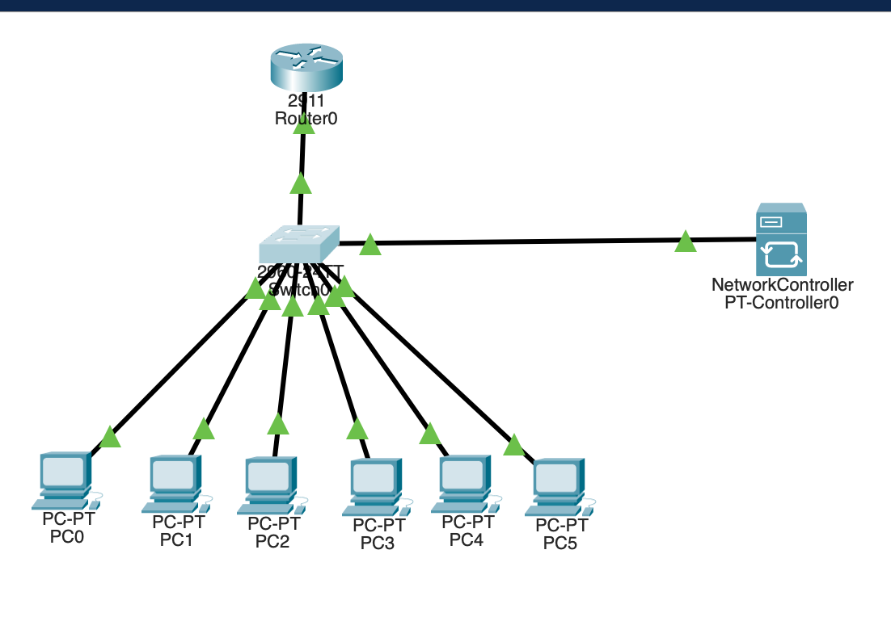

# Cisco Packet Tracer — Small Business Network Lab

This folder contains the [Cisco Packet Tracer simulation](Small-Business-Network-Lab-git.pkt) used in the [Small Business Network Monitoring Lab](../README.md).

The lab models a small business network with three departments, inter-VLAN routing, DHCP, access restrictions and a Packet Tracer Network Controller that supplies health data to a separate Python/Docker monitoring dashboard.

## Network topology

| Department | VLAN | Subnet | Default gateway |
| --- | --- | --- | --- |
| IT | 10 | `192.168.10.0/24` | `192.168.10.1` |
| Finance | 20 | `192.168.20.0/24` | `192.168.20.1` |
| HR | 30 | `192.168.30.0/24` | `192.168.30.1` |

**Devices:** Cisco 2911 router, Cisco 2960 switch, six simulated workstations and one Packet Tracer Network Controller.

## Features configured

- Departmental VLANs and access-port assignments
- 802.1Q trunk between router and switch
- Router-on-a-stick inter-VLAN routing
- DHCP pools for IT, Finance and HR
- Extended ACL restricting HR-to-Finance traffic
- SSH-based router and switch administration
- Switch management addressing and buffered syslog events

## Open and verify the lab

1. Download [Small-Business-Network-Lab-git.pkt](Small-Business-Network-Lab-git.pkt) and open it in **Cisco Packet Tracer**.
2. Check VLAN assignments on the switch using `show vlan brief` and the trunk using `show interfaces trunk`.
3. On the router, inspect `show ip interface brief` and `show ip route` to confirm the three VLAN interfaces and routing.
4. Inspect DHCP-assigned host addresses and their default gateways.
5. Test connectivity. The configured policy blocks **HR → Finance** while allowing **HR → IT** and **IT → Finance**.
6. Examine the Packet Tracer Network Controller's health and inventory views.

## Monitoring integration

The Network Controller exposes a REST API to the Python collector running on macOS. The collector saves health snapshots and incident records, which the Docker-hosted Nginx dashboard serves locally.

For the dashboard setup and collector commands, see the [main project README](../README.md).

**Known limitation:** The router was operational in the simulation but did not appear in the controller's managed inventory during testing. The controller's switch-health reporting also fluctuated.

## Supporting evidence

- [VLAN configuration](../screenshots/02-vlan-segmentation.png)
- [DHCP configuration](../screenshots/03-dhcp-configuration.png)
- [Controller health](../screenshots/04-controller-health.png)
- [Switch syslog events](../screenshots/10-syslog-link-events.png)
- [Documented incident test](../docs/INCIDENT-REPORT.md)
